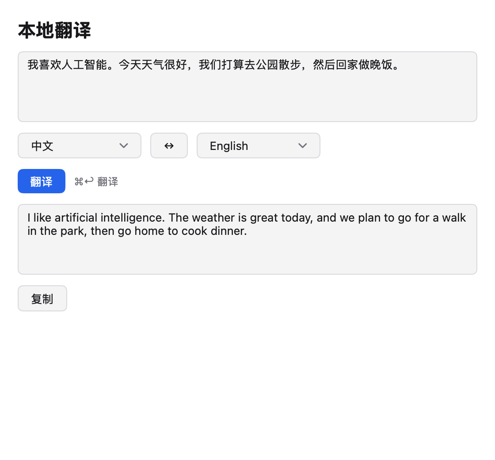

# MyGo 本地翻译

用 [MyGo](https://github.com/egoist/mygo) 原生 UI 写的桌面翻译应用：左边写中文，右边出英文。
翻译由**本机**的 [Ollama](https://ollama.com) 完成，文本不出本机。

界面全部由 MyGo 自己画（`ui` 包，原生控件），没有 webview，没有前端构建。



## 特点

- **纯本地**：请求打到 `http://localhost:11434`，不经过任何云服务
- **多语言**：14 种语言互译，源语言和目标语言各自选，中间一键交换
- **不卡界面**：模型在后台算，翻译期间按钮禁用并转菊花，结果回来才更新
- **结果可复制**：一键复制到剪贴板
- **快捷键**：⌘↩ 翻译（Windows / Linux 上是 Ctrl↩）

## 准备

需要 Go 1.27+ 和 MyGo 的开发环境：

```sh
go tool mygo doctor
```

装好 Ollama 和翻译模型：

```sh
ollama pull s2021008840/hy-mt2:1.8b
```

> 模型是腾讯的 [Hy-MT2](https://huggingface.co/tencent/HY-MT2)（1.8B，Q4_K_M 量化，约 1.1 GB）。
> 纯 CPU 就能跑，Apple M4 上翻一句话大约 0.5 秒。

## 运行

```sh
go tool mygo dev     # 开发构建，改代码自动重载
go tool mygo build   # 产出 .app 和 .dmg，在 build/darwin-arm64/
```

## 配置

用环境变量覆盖默认值：

| 变量 | 默认值 | 说明 |
|---|---|---|
| `OLLAMA_HOST` | `http://localhost:11434` | Ollama 服务地址 |
| `OLLAMA_MODEL` | `s2021008840/hy-mt2:1.8b` | 翻译模型 |

```sh
OLLAMA_MODEL=other/model go tool mygo dev
```

## 它是怎么工作的

应用把源文本和两种语言拼成一个 prompt，打到 Ollama 的 `/api/generate`：

```
Translate from Chinese to English: 我喜欢人工智能。
```

**这个前缀是必须的。** 不带它，模型会把原文当成对话的开头，续写一大段和翻译无关的内容。
`translate_test.go` 里有断言守着这个格式。

模型只认英文的语言名，所以界面上显示「中文」，发给模型的是 `Chinese`（14 种语言各有一个英文名）。

## 项目结构

```
main.go            界面：状态、布局、异步翻译
translate.go       Ollama 客户端：prompt、HTTP、错误处理、语言表
main_test.go       界面测试（ui.NewTester 驱动）
translate_test.go  HTTP 层测试（httptest 假服务器）
screenshot_test.go 生成 README 顶图
e2e.go             打开 automation 插件的构建标签（只在 -tags e2e 时生效）
e2e/drive.py       驱动真正的 app：填文本、按按钮、截图、验剪贴板
mygo.json          应用名、标识、版本
```

## 测试

```sh
CGO_ENABLED=0 go test ./...   # 12 个测试，不需要 ollama 起着
go test -race ./...            # 异步部分必须过 race
go tool mygo vet .             # 原生 UI 生命周期检查
```

界面测试用 `ui.NewTester`，不用开窗口就能点按钮、敲键盘：

```go
tt := ui.NewTester(app.view, 560, 520)
tt.Click("源文本")
tt.Type("我喜欢人工智能")
tt.Click("翻译")
```

HTTP 层用 `httptest` 起一个假 Ollama，验证请求路径、prompt 格式和各类错误。

README 顶上那张图是用 `ui.Render` 画的（不需要截屏权限）。改完界面重新生成：

```sh
RENDER_PNG=1 go test -run TestScreenshot   # 需要 ollama 起着
```

### 驱动真正的 app

`go test` 里的 tester 只跑视图。要验证打包后的 app，用 MyGo 的
[automation 插件](https://github.com/egoist/mygo/blob/main/docs/plugins/automation.md)：

```sh
go build -tags e2e -o /tmp/mygo-e2e .
MYGO_AUTOMATION=/tmp/mygo-e2e.sock /tmp/mygo-e2e &
python3 e2e/drive.py
```

驱动脚本会填入中文、点「翻译」、等模型回答、读元素树、截图，并核对复制按钮是否把译文放进了剪贴板；
然后交换语言再翻一次。图片写在 `/tmp/app-*.png`。

## 已知限制

- **窗口大小会被记住**。`StateKey` 把窗口上次的位置和大小存在
  `~/Library/Application Support/mygo-native-app-test/window-state.json`，
  改了代码里的 `Width`/`Height` 却不生效时，删掉这个文件即可。
- **长文本要分段**。1.8B 的模型上下文够用，但一次塞一整篇文章会明显变慢。
- **模型质量有限**。1.8B 的量化模型，文学性翻译和长句准确率不如在线服务，
  商务和技术文档这类规整文本最稳。

## 更多

- MyGo 文档：<https://github.com/egoist/mygo/tree/main/docs>
- 本项目的开发笔记（MyGo 原生 UI 的坑、模型行为实测）：见 [CLAUDE.md](CLAUDE.md)
